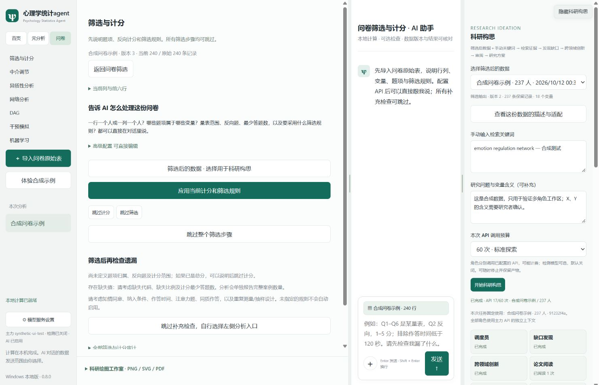

# 心理学统计 agent

面向心理学研究的中文桌面分析助手。安装后即可使用本地统计计算，配置自己的模型 API 后，可通过 AI 对话规划分析、核对遗漏和形成科研方案。

**当前版本：0.8.0 · Windows 64 位测试版**

[下载安装包](https://github.com/awardtome/psychology-statistics-agent/releases/download/v0.8.0/Psychology-Statistics-Agent-0.8.0-Setup.exe) · [版本发布与源码](https://github.com/awardtome/psychology-statistics-agent/releases/tag/v0.8.0) · [完整中文说明](agent/desktop/README.zh-CN.md)

## 开始使用

1. 下载并运行 `Psychology-Statistics-Agent-0.8.0-Setup.exe`，安装后打开“心理学统计agent”。日常使用无需另行安装 R、RStudio 或 Node。
2. 在“模型服务设置”配置自己的主力 API 和模型 ID，确认数据发送范围。支持 Responses 和兼容 Chat Completions 的服务；第三方模型需要支持工具调用。检测模型可选，默认关闭。
3. 选择“元分析”或“问卷”。问卷入口负责筛选和计分，完成后自行进入各分析页面，并确认使用哪份数据。
4. 需要科研构思时，打开右上角“科研构思”，选择一份筛选后的数据，手动填写检索关键词，再开始任务。

## 分析工作区

| 入口 | 使用方式 |
|---|---|
| 元分析 | 导入编码表，确认效应量、研究编号及分析方案，查看实际结果与审计 |
| 问卷筛选 | 说明行列、题项归属、反向计分与筛选规则；可添加规则附件，各筛选步骤可跳过 |
| 中介调节 | 确认变量后，在画布上安排路径；左键添加、右键删除，调节箭头指向被调节路径 |
| 异质性 | 潜在剖面、潜在类别或网络树；网络树明确指定节点变量和分裂变量 |
| 网络 | 规划题项、分量表或总分节点，计算 GGM/Ising 网络、稳定性及适用的组间比较 |
| DAG | HC、Tabu、MMHC、PC、GES、FCI 与方向不确定性说明 |
| 干预 | IDA，或导出 NIRApost/GGMNIRA 长时计算任务，指定干预目标并返回结果解读 |
| 机器学习 | 明确目标、特征与训练/测试划分，查看基线及随机森林结果 |

分析导出完整 Excel 和 Word 报告；适用的方法同时提供科研图片。内嵌绘图工具从实际计算结果作图，提供固定科研模板和导出设置。

## 科研构思

以**筛选后的数据＋手动检索关键词**为输入，任务固定绑定使用者选择的数据快照。切换左侧文件、分组或分析入口不会改变已启动任务的数据来源。

调度、缺口发现、跨领域创新、方案审阅、论文阅读和报告撰写各有独立上下文与工具权限。全部使用使用者配置的 API；开启可选检测模型后，审阅角色可使用检测 API。文献支持继续分页、阅读摘要、证据等级与工具审计，方案可独立导出 Excel 和 Word。

可选导入 [Svalbard Idea Vault](https://huggingface.co/datasets/Jerry999/SvalbardIdeaVault) 的 JSONL/JSONL.ZST 分片，建立本机检索索引。生成注释会与原论文区分，安装包不内置整个数据库。多角色与工具设计参照 [IdeaScientist](https://github.com/jiarui-liu/IdeaScientist) 独立实现，没有使用作者的训练模型或复现其训练与评测成绩。

## 数据与适用范围

原始表在本机计算；AI 调用会按模型设置中确认的范围向使用者选择的服务发送信息。科研构思只使用所选筛选后快照的摘要、手动关键词和研究问题。详细发送范围与方法限制见[完整说明](agent/desktop/README.zh-CN.md)。

本版为未签名测试版。主分析工作区退出前需导出，科研构思快照和上次任务可在本机保留。NIRApost/GGMNIRA 长时任务导出到外部 R 环境运行。观察性关联、DAG 和模拟干预不能自动解释为真实因果效果。

## 源码与开发

- [桌面程序](agent/desktop)：Electron、JavaScript 与本地统计后端。
- [构建说明](docs/BUILD.zh-CN.md)：开发测试、准备内置计算环境和打包。
- [元分析计算依赖](vendor/meta3level)：按固定上游版本保留的源码快照。
- [第三方来源与许可证](THIRD_PARTY_NOTICES.md)。

51 项软件测试通过；已用合成数据验证打包程序、中文路径安装、问卷筛选、元分析、DAG、绘图和报告导出。API 流程使用模拟服务测试。独立仓库迁移保留已验证的 0.8.0 安装包，调整源码布局、构建路径和项目文档。
